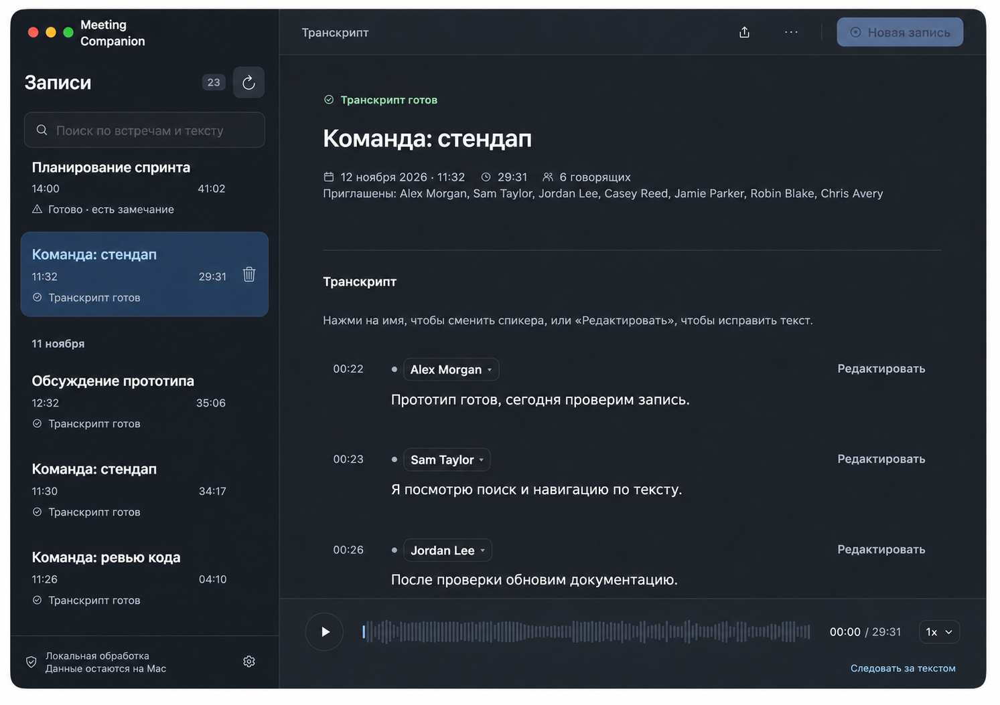

# Meeting Companion

Локальная запись и расшифровка встреч на macOS 15+ с Apple Silicon.
Приложение записывает микрофон и системный звук, создаёт текст с таймкодами
и разделением голосов. Аудио остаётся на Mac. После скачивания моделей
распознавание работает офлайн; Python и внешние сервисы не нужны.

Библиотека встреч, расшифровка и плеер в одном окне:



Во время записи остаётся компактная капсула управления:


*Имена, названия встреч и реплики на изображениях вымышлены.*

## Установка

**Стабильная версия — 2.0.1.**
[Скачать DMG для Apple Silicon](https://github.com/spryka/meeting-companion/releases/download/v2.0.1/Meeting-Companion-2.0.1-arm64.dmg)
· [Все версии](https://github.com/spryka/meeting-companion/releases)
· [История изменений](CHANGELOG.md)

**Бета — 2.1.0-beta.2, build 88:**
[скачать DMG с компактным напоминанием](https://github.com/spryka/meeting-companion/releases/download/v2.1.0-beta.2/Meeting-Companion-2.1.0-beta.2-arm64.dmg).

Откройте DMG, перенесите Meeting Companion в «Программы» и извлеките образ.
Для замены установленной версии сначала завершите запись, обработку и
подготовку моделей, затем закройте приложение. Записи и модели хранятся отдельно.

### Первый запуск и предупреждение macOS

Сборки с GitHub подписаны локальным сертификатом, без Apple Developer ID и
Apple notarization — проверки приложения компанией Apple. Поэтому Gatekeeper
может заблокировать первый запуск сообщением «Apple не удалось подтвердить,
что файл не содержит вредоносного ПО». Для запуска нужно явно разрешить
открытие этого приложения.

Если вы скачали сборку из GitHub Releases этого проекта и доверяете ей:

1. В окне предупреждения нажмите **«Готово»**.
2. Откройте **Системные настройки → Конфиденциальность и безопасность**.
3. Прокрутите вниз до сообщения о Meeting Companion, нажмите
   **«Всё равно открыть»** и подтвердите запуск. При запросе пройдите
   аутентификацию паролем или Touch ID.

Это разрешение для конкретного приложения; отключать Gatekeeper не требуется.
Подробнее: [инструкция Apple](https://support.apple.com/ru-ru/102445).

### Обновления

Дальнейшие обновления доступны через «Проверить обновления…» в меню приложения.
Бета-канал включается в «Настройки → Основные → Получать бета-версии»;
его отключение не откатывает установленную версию. Для старых сборок без
обновления из приложения один раз установите текущий DMG.

## Первая запись

1. Откройте «Настройки → Транскрибация», нажмите «Скачать» и дождитесь подготовки моделей.
2. Нажмите «Новая запись», выберите встречу или «Без встречи», микрофон и,
   при необходимости, название. Разрешите доступ к микрофону и системному звуку по запросу macOS.
3. После начала записи основное окно скрывается. Капсула управления показывает
   длительность в полных минутах. Библиотеку можно открыть из строки меню,
   не останавливая запись.
4. Остановите запись. Во время локальной обработки значок остаётся в строке меню,
   а капсула показывает номер и название этапа. «Подробнее» открывает весь
   маршрут обработки, «Открыть» — готовый текст.

Выключение микрофона в капсуле не влияет на системный звук или настройки
приложения для звонков. До десяти секунд доступна явная отмена короткой записи:
исходники перемещаются в Корзину, распознавание не запускается.

Следующую встречу можно записывать, пока предыдущая обрабатывается.
Закрытие библиотеки не прерывает обработку. Капсула обработки скрывается после
успешного открытия результата или через минуту после завершения.

## Календарь и напоминания

Календарь необязателен. Приложение читает выбранные календари macOS,
предлагает встречу и напоминает о её начале. По умолчанию учитываются события
со ссылкой на звонок. События не изменяются; подключения к звонку нет.

В напоминании можно выбрать другую встречу или «Без встречи».
Если запись уже идёт, показаны её название и длительность. Действие
«Завершить и начать новую» сначала завершает текущую запись; при ошибке
новая запись не начинается. Запись короче десяти секунд отменяется, более
длинная сохраняется и отправляется на обработку.

Капсула напоминает об окончании встречи или о часе записи без неё.
Напоминание можно отложить на 15 минут. Автоматической остановки нет;
контекст начатой записи не меняется вслед за календарём.

## Библиотека и текст

В одном окне доступны список встреч, поиск по названию и тексту, расшифровка
и плеер. В узком окне кнопка «Все записи» возвращает к списку.

- Кнопка обновления и `⌘R` перечитывают папку записей, включая встречи,
  восстановленные из Корзины. Поиск, открытый текст и воспроизведение
  сохраняются, пока выбранная запись доступна.
- Текст и имена говорящих можно исправлять. Редактор предлагает имена
  участников встречи и сохранённые голоса.
- Плеер поддерживает таймкоды, звуковую волну, скорости 1×/1.25×/1.5×/2×
  и следование за текстом. Ручная прокрутка приостанавливает следование.
- Экспорт сохраняет текст с текущими правками и именами. Речь и календарный
  контекст не анонимизируются.
- «В Корзину…» перемещает целиком отдельную папку записи, включая аудио,
  результаты и правки. Занятые записи защищены. Восстановление доступно через Finder.
- «Повторить обработку» создаёт новый результат. Прежние файлы и правки
  сохраняются на диске; правки не переносятся в новый результат автоматически.

Несохранённый ввод защищён от конфликтующих действий. Недоступное аудио
не закрывает сохранённый текст. При ошибке чтения библиотеки прежний список
остаётся доступен. Подробности: [редактирование и экспорт](docs/transcript-editor.md).

### Имена участников

Имя у реплики и счётчик говорящих в шапке открывают один редактор. У реплики
начальная область — одна реплика, у счётчика — вся группа. Выберите область и
проверьте число затронутых реплик перед «Применить». Замена прежних ручных имён
требует отдельного разрешения. «Следующий голос» только переключает выбор.

«Неопознанные» показывает группы, в которых ещё есть реплики без имени.
Возврат к тексту сохраняет черновики текущего результата. Перед сменой встречи
или повторной обработкой примените или отмените правку. К сохранённому черновику
можно перейти кнопкой «Вернуться к правке».

В «Настройки → Голоса» можно включить экспериментальное локальное запоминание,
подготовить модель и управлять профилями. Когда запоминание включено, новое
ручное имя запускает обучение при сохранении. Если совпало несколько профилей,
выберите человека рядом с полем имени. У старого имени без профиля нажмите
«Подтвердить имя для обучения» рядом с прослушанной репликой. Запоминание
по умолчанию выключено. Когда оно включено и модель подготовлена, при
обработке записи приложение проверяет совпадения с локальными профилями.
Имя сохраняется при достаточной уверенности. Ручные имена имеют приоритет.

| Клавиши | Действие |
|---|---|
| `⌘N` | Новая запись |
| `⌘F` | Поиск |
| `⌘R` | Обновить библиотеку |
| `⌘,` | Настройки |
| Пробел | Воспроизведение / пауза |
| `←` / `→` | Перемотка на −5 / +5 секунд |
| `↑` / `↓` | Предыдущая / следующая встреча или реплика в активной области |
| Delete / Backspace в списке | Подтверждение переноса в Корзину |
| Enter в подтверждении удаления | Переместить в Корзину |
| `Esc` | Закрыть настройки или верхнюю форму |

Стрелки можно удерживать. В полях ввода и нативных контролах клавиши сохраняют
обычные действия. `Esc` не прерывает запись или обработку.

## Настройки

- **Основные:** тема, запуск при входе, следование за текстом, обновления.
- **Запись:** микрофон, проверка звука, эхоподавление WebRTC AEC3, папка записей.
  Core Audio Tap используется по умолчанию; ScreenCaptureKit доступен в «Дополнительно».
- **Транскрибация:** подготовка и проверка моделей, коррекция терминов Parakeet, сброс кэша.
- **Календарь:** выбор календарей и фильтрация встреч со ссылкой на звонок.
- **Голоса:** локальное определение голосов, подготовка модели и профили.
- **Диагностика:** разрешения macOS, проверка звука и журнал.

С включённой настройкой «Запускать при входе» приложение появляется в строке
меню после входа в macOS, а главное окно остаётся скрытым. Его можно открыть
из Finder или командой «Библиотека» в строке меню.

Проверка звука длится до 30 секунд. Эхоподавление выключено по умолчанию;
с наушниками его обычно не требуется включать. Недоступный микрофон
не заменяется другим автоматически.

«Сбросить кэш…» удаляет только модели и runtime из каталога приложения.
Записи, тексты, настройки, разрешения и общие кэши сохраняются.
После сброса модели потребуется скачать заново.

## Данные и совместимость

Записи по умолчанию: `~/Downloads/Meetings/YYYY-MM/DD/NAME/`.
Итоговый текст, календарный контекст и M4A находятся в папке встречи;
исходные WAV, журналы и промежуточные результаты — в `raw/`.
Микрофон и системный звук сохраняются раздельно на общей шкале времени.

Полные функции доступны для стандартной папки `NAME/NAME.m4a` с поддерживаемым
результатом JSON v1. Старое плоское размещение поддерживает список и собственный
сохранённый TXT только для чтения. Автоматической миграции нет.

Новые назначения имён могут создать `edits.json` v2. Для редактирования и
экспорта таких правок нужна версия с поддержкой v2. Перед откатом сохраните
экспорт готового текста. Голосовые профили хранятся отдельно в
`Application Support/MeetingCompanion/VoiceProfiles`. Сброс кэша моделей и
удаление профиля сохраняют ранее опубликованные имена в тексте встреч.

GigaAM распознаёт русскую речь, Nemotron разделяет голоса и определяет окна
распознавания. Parakeet дополнительно уточняет термины; исходный текст
сохраняется. Распознавание и разделение голосов могут ошибаться.

При сбое обработки аудио и журналы сохраняются. После устранения причины
доступна повторная обработка. Незавершённые задания после перезапуска
не продолжаются автоматически. Обновление приложения не перераспознаёт старые записи.

[Устройство конвейера](docs/transcription-pipeline.md)
· [Работа с готовым текстом](docs/working-with-transcripts.md)
· [Эхоподавление](docs/webrtc-aec-experiment.md)

## Сборка и разработка

Нужны Apple Silicon, macOS 15+, Xcode со Swift 6 и Metal Toolchain.
SwiftPM скачивает зависимости; веса моделей в приложение не входят.

```sh
git clone https://github.com/spryka/meeting-companion.git
cd meeting-companion
export DEVELOPER_DIR=/Applications/Xcode.app/Contents/Developer
./scripts/build-app.sh
```

Результат — `dist/Meeting Companion.app`. Для локальной установки после выхода
из приложения: `./scripts/install-app.sh`. Этот скрипт заново собирает приложение.
По умолчанию подпись ad-hoc. Для регулярных обновлений используйте один
`CODESIGN_IDENTITY` или локальный `.codesign/identity`: смена подписи может
потребовать повторной выдачи разрешений. Разрешения автоматически не сбрасываются.

Локальные сборки отключают Sparkle. Публичная сборка создаётся с
`RELEASE_UPDATES=1 ./scripts/build-app.sh`, затем `scripts/build-dmg.sh`
и `scripts/prepare-update.sh`. Для обновлений нужны прежние ключи подписи,
новые SemVer и build. Архив публикуется до изменения `appcast.xml`;
опубликованные архивы не перезаписываются.

`scripts/build-dmg.sh` добавляет рядом с приложением файл «Установка.txt»
из [Resources/Installation.txt](Resources/Installation.txt) с инструкцией первого запуска.

```sh
swift build -c release
swift test
bash scripts/check-module-boundaries.sh
swift skills/local-audio-transcriber/scripts/find-recording.swift --self-test
./scripts/check-bundle.sh "dist/Meeting Companion.app"
openspec validate --all --strict
```

Тесты с нативным UI и аудио требуют macOS и соответствующего окружения.
Проверки реальных устройств, качества звука и доступности выполняются отдельно.

[Участие в разработке](CONTRIBUTING.md)
· [Архитектура](adr/)
· [Лицензия MIT](LICENSE)
· [Зависимости и модели](THIRD_PARTY.md)

Спасибо [Charoite](https://github.com/charoiteai/Charoite_audio) за идею локального помощника для встреч.
