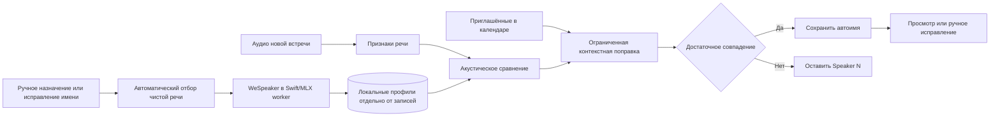

# ADR-0008: Локальные голосовые профили и автоматическое назначение имён

Status: accepted
Date: 2026-11-18
Supersedes: ADR-0007 — только состав разделов Settings.

## Context

Nemotron разделяет голоса внутри записи, но его локальные номера не являются
устойчивыми идентификаторами людей между встречами. Ручные имена уже хранятся
отдельно от распознавания. Хотим использовать проверенные образцы речи, чтобы
предлагать знакомые имена в следующих записях, сохраняя возможность отказа.

[Swift/MLX PoC](../experiments/voice-identity/README.md) проверен на двух разных
размеченных встречах: шесть общих участников, 134 фрагмента. Top-1: 62/70 и 58/64,
macro accuracy: 88.6% и 85.8%. При исследовательском cosine-пороге 0.7 приняты
73/134 фрагмента, без ошибочных принятых назначений в этой выборке. Это не
калибровка: отдельной validation-выборки и действительно новых голосов не было.
Есть заметная путаница отдельных участников. Нулевой размеченный фрагмент исключён.

Владелец согласовал целевой макет и уточнения после независимого ревью совместимости
(тред thr_uaqvxmvuy7). Контракт реализации и проверки находятся в OpenSpec change
local-voice-identity. Решение описывает целевое поведение.

## Decision

### 1. Пользовательский сценарий

В настройках есть необязательное локальное запоминание голосов. Его включение
разрешает использовать ручную разметку для создания и уточнения профилей.
В основном сценарии пользователь только назначает или исправляет имя обычным
способом. Программа сама выбирает пригодные фрагменты, вычисляет признаки и
обновляет профиль. Обязательного интерфейса выбора и прослушивания образцов нет.
Для уже размеченных встреч есть одно действие импорта выбранных записей.
Обычное открытие библиотеки не запускает импорт, модели или скачивание.

При включённой функции приложение один раз сопоставляет голоса нового результата,
также после явного retry. После публикации ASR уверенные имена сохраняются правками.
Готовая запись открывается в режиме чтения сохранённых назначений. Ручные имена
имеют приоритет. Единый редактор доступен из реплики и шапки транскрипта.
Управление профилями находится в шестом разделе «Голоса» существующей модалки.

### 2. Модель и совместимость

Начальный кандидат: WeSpeaker ResNet34-LM, готовые Swift/MLX network и frontend,
256-мерные L2-нормированные векторы. Веса и источник реализации закрепляются
ревизиями и SHA-256, как в PoC. Самостоятельный порт сети не нужен.

`embeddingSpaceID` включает хеш весов, frontend и локальных исправлений,
параметры признаков, backend, размерность и нормализацию. Одинаковые 256 чисел
не означают совместимость разных моделей, MLX/Core ML/PyTorch. Политики нарезки,
отбора, обновления и scoring также версионируются. Подмена модели, backend или
точности без явной смены версии исключена.

Несовместимые старые векторы сохраняются, но не сравниваются с новыми. Пересчёт
из доступных исходников выполняется явно; при их отсутствии профиль можно
пополнить новыми ручными назначениями. До распространения весов нужно разрешить
отмеченное в PoC расхождение лицензий конверсии и оригинала.

### 3. Постоянный локальный каталог

Каталог находится в принадлежащем приложению Application Support, отдельно от
папок записей и runtime/model cache. Это пользовательские данные, не временный
кэш. Он применяется к записям пользователя на этом Mac, без автоматической
синхронизации, выгрузки или передачи аудио.

- У человека стабильный `personID` (UUID), отображаемое имя и подтверждённые
  связи с участниками календаря. Совпадение строк не объединяет разных людей.
- Образец содержит `sampleID`, `personID`, embedding, `embeddingSpaceID`,
  длительность, запись/resultID/turnID/sourceID, интервал, отпечаток PCM,
  происхождение имени и версию назначения. Сырые аудиокопии не создаются.
- Каталог хранит сами векторы и сведения о подтверждённой ручной разметке,
  а не ссылки, по которым надо заново строить профиль при каждом открытии.
  После удаления аудио или всей записи профиль продолжает работать.
  Недоступный источник ограничивает аудит и пересчёт, но не отзывает знание голоса.
- Удаление записей, перенос в Корзину и очистка аудио не удаляют профили.
  Сброс моделей не удаляет каталог. Выключение функции прекращает её работу
  и отменяет незавершённое обучение, но сохраняет накопленную базу.
- Удаление человека или всего каталога является отдельным явным действием.
  Переименование человека не переписывает уже сохранённые имена в транскриптах.

Один вектор Float32 занимает 1024 байта; ограниченный набор эталонов с профилем
и метаданными имеет порядок десятков КБ на человека, в зависимости от кодирования.
Здесь не хранится ни сама модель, ни аудиозапись. Основной UI настроек содержит
переключатель, список людей, состояние профиля и удаление; управление каждым
фрагментом не требуется. Детальная диагностика не является шагом обычного сценария.

Достаточно одного версионированного документа каталога без новой СУБД.
Писатель Application использует блокировку, revision/CAS и атомарную замену.
Ошибка или конфликт сохраняют предыдущий документ. Повреждённый/неподдерживаемый
каталог не сбрасывается автоматически, базовые запись и редактор доступны.

### 4. Автоматический отбор и начальный профиль

1. После включения функции успешное ручное назначение ставит извлечение
   кандидатов в очередь. Имя связывается с конкретным `personID`; неоднозначность
   людей разрешается при обычном назначении имени, не при выборе аудиофрагментов.
2. Для current стандартной записи берутся конкретные размеченные интервалы,
   а не все голоса speakerID целиком, список приглашённых или владелец микрофона.
   Источник: фактический recognition WAV версии, включая применённый AEC.
3. Программа отбирает достаточно длинные чистые участки. Доступные интервалы
   Nemotron используются для исключения наложений и участков без речи.
   В уже сохранённых документах frame probabilities и полные интервалы могут
   отсутствовать: границы реплик и известные пересечения используются без
   выдуманного confidence или скрытого повторного запуска диаризации.
   Для новых результатов необходимые сигналы качества нужно сохранять явно.
4. Начальные параметры из PoC: окна 3–6 секунд, внешний отступ 150 мс,
   защита от известного голоса той же дорожки 100 мс. Это проверяемые параметры,
   не гарантия отсутствия примеси. Длинная реплика не выбирается целиком только
   из-за длины; паузы и удалённые участки не склеиваются. Несколько окон
   распределяются по времени, память ограничивается текущим окном.
5. Полностью нулевые окна исключаются с причиной. Неконечные данные, неверные
   границы или отсутствующий источник завершают необязательную операцию ошибкой.
   Нет подмены миксом, другой дорожкой или соседней версией результата.
6. Предлагаемый стартовый минимум: три пригодных фрагмента и 12 секунд речи,
   максимум 12 эталонов на человека. Ограничивается также вклад одной встречи.
   Минимумы, лимит встречи и критерий согласованности требуют калибровки.
   Массовая правка имени не объединяет speakerID в доказанную личность:
   противоречивые кандидаты не активируются автоматически.
7. Для нормированных эталонов `e_i` профиль равен `normalize(sum(e_i))`.
   Нулевая норма и неконечные значения не создают профиль. Отдельные эталоны
   сохраняются для исправления ошибочного вклада и пересчёта.
8. После проверки source/assignment snapshot результат фиксируется одним commit
   каталога. Ошибка, отмена или недостаток пригодного материала сохраняют
   предыдущий рабочий профиль, с понятным состоянием незавершённого обновления.

### 5. Уточнение профиля без нового обязательного UI

Обычные новые ручные назначения и исправления дают дополнительный материал.
Программа автоматически отбирает ограниченный набор репрезентативных эталонов
и пересчитывает профиль. Одна длинная или ошибочно размеченная встреча не должна
вытеснять материал остальных. Сильно противоречащие кандидаты не заменяют
рабочий профиль: остаются неактивными до независимых согласованных ручных
назначений другой встречи. Разбор каждого образца не становится обязанностью
пользователя. Правила допуска и замены версионируются и проверяются отдельно.

Это обновление профиля, не обучение весов WeSpeaker. Имя, предложенное моделью,
и простое принятие подсказки не являются независимой обучающей разметкой.
Ручной выбор или исправление личности являются. Происхождение и идентификатор
назначения должны сохраняться атомарно вместе с именем в правках. Изменение
формата правок и совместимость с прежними версиями описываются в OpenSpec.
Legacy-разметка без происхождения допускается только при явном импорте
пользователем как ручной. Это не разрешает безусловно импортировать будущие
автоподписи из файлов без признака происхождения.

Вклад идентифицируется по записи/resultID/turnID/интервалу/PCM/назначению.
Повторная обработка той же разметки не увеличивает вес. Исправление человека
отзывает прежний вклад и создаёт материал для нового; исправление только текста
не переучивает голос. Каталог пересчитывается из оставшихся эталонов.

Сохранение имени и подтверждение обучения являются разными commit. Для сбоев
нужен durable learning-event/outbox с проверкой факта сохранения ручной правки.
Незавершённое исправление не должно восстанавливать отозванный вклад после
перезапуска. Удаление записи приложением не теряет уже принятые события
исправления; события должны переживать удаление источника. Порядок commit,
reconciliation и отказов обязателен в design до реализации. Успешным обучение
считается только после commit каталога; его сбой не блокирует сохранение имени.

### 6. Сопоставление и календарный контекст

1. Задание для нового результата фиксирует resultID, revision правок/каталога, model/policy
   fingerprint и идентичность source WAV. Имена уже сохранённых ручных
   назначений не перезаписываются.
2. Сравниваются все совместимые профили. Гости не исключаются. Первая версия
   требует два профиля для top-2 margin; единственный профиль остаётся доступен
   для накопления, автоимена в этом случае не сохраняются.
3. При однозначной подтверждённой связи профиля с приглашённым используется
   ограниченный бонус. Связь можно сохранить при обычном ручном выборе участника
   календаря; простого совпадения неоднозначных имён недостаточно. Неизвестная
   связь и отсутствующий календарь дают нулевой бонус.
4. Для каждого окна: `s_i = cosine(query, profile_i)`, `r_i = s_i + b_i`,
   где `0 <= b_i <= B`. `r_i` является контекстным ranking, не вероятностью.
   Победитель `w` допускается только при `s_w >= T`, `r_w - r_second >= D`
   и `max(s_i) - s_w <= G`. Так календарь может разрешить близкое сравнение,
   но не вытянуть акустически неподходящий голос. `T/D/B/G` калибруются вместе,
   отдельно измеряется ошибка на неприглашённых и режим без календаря.
5. Для автоматического назначения имени целой реплике все пригодные окна должны согласиться
   на одном человеке и пройти проверки. Длинная реплика покрывается окнами
   до шести секунд, короткий остаток можно покрыть перекрывающимся последним
   окном. При короткой речи, известном наложении, конфликте окон или неполном
   пригодном покрытии сохраняется Speaker N. Усреднение не скрывает конфликт.
6. Нельзя распространять имя по speakerID на другие реплики или источники
   и нельзя навязывать назначение один-к-одному. Одна метка Nemotron может
   содержать разных людей, один человек может быть на обеих дорожках.
   Предупреждения о восьми голосах на источник сохраняются.

Порог 0.7 из PoC, margin, календарный бонус и автоматическое обновление
не являются проверенной продуктовой политикой. До независимой калибровки
функция остаётся экспериментальной.

### 7. Сохранение имён, совместимость и выполнение

Автоимена сохраняет Application отдельным атомарным commit правок нового current.
Copy/Export читают сохранённые правки с приоритетом ручного имени. Отказ или сбой
сопоставления оставляет транскрипт доступным. Единый редактор использует обычный
preview/CAS/lock. При входе из реплики начальная область — одна реплика, из шапки —
группа. Распространение автоимени сохраняет машинное происхождение и исключено
из обучения. `result.json`, таймкоды и исходные Speaker IDs неизменны.
Retry создаёт новый current без переноса старых turnID и правок.

MLX и аудиопризнаки принадлежат существующему Swift worker. Добавляется вид
задания embeddings одной записи с версией протокола, отменой и ограничением
памяти. Worker не пишет каталог и правки. Core хранит каталог и считает cosine;
Application владеет заданиями/snapshot; Platform запускает worker; App показывает
результат. App/CLI не импортируют MLX/Pipeline. Используется общий исполнитель
тяжёлых заданий, без второго scheduler и без остановки capture/чужой ASR.

Автоопределение привязано к current и источникам записи. Оба вида фоновой работы
принадлежат Application и переживают закрытие UI.
Оно привязано к сохранённому назначению конкретного источника, а не к выбранной
строке библиотеки. Смена назначения, personID, модели/политики, выключение функции
и удаление человека инвалидируют соответствующие pending jobs. Устаревший
callback не применяет имя и не воскрешает удалённый профиль.

Перед чтением проверяются canonical containment, схема, source/result identity;
аудио snapshot проверяется до/после чтения, выход содержит отпечатки PCM-окон.
Для утраты аудио нет смены source/backend. Повреждённый каталог, модель или
неверный вход завершают только необязательное задание. Базовый редактор остаётся
доступен без моделей. Не появляются фоновое скачивание и скрытый пересчёт
записей при открытии. Показанное состояние обучения отражает его реальный commit.

## Validation

- Enrollment, calibration и blind test разделяются по целым встречам. Параметры
  отбора/обновления, `T/D/B/G` и допустимые сигналы качества замораживаются
  до blind test. После подстройки по его результатам нужна новая test-встреча.
- Проверяются действительно новые люди, гости вопреки календарю, одноимённые
  приглашённые, неверные приглашения, режим без календаря, разные микрофоны,
  шум, молчание, наложения, смена говорящего внутри реплики и ошибочная разметка.
- Считаются top-1, macro/per-person ошибки, precision/coverage сохранённых автоимён,
  false acceptance гостей и знаменатели. Ноль ошибок на малой выборке не равен
  доказанной нулевой ошибке. Проверяется весь путь до имени реплики, не только
  заранее выбранные чистые окна.
- Learning-проверки: ручное имя против принятой подсказки; legacy import;
  идемпотентность и лимит одной встречи; исправление ошибочного personID;
  шумный кандидат; повторное подтверждение другой встречи; сбой между commit
  правок и каталога; restart/outbox; удаление источника с pending событием;
  удаление записи без потери профиля; несовместимость embeddingSpaceID;
  отключение функции и сохранение базы; model cache reset; CAS/cancel/staleness.
- Native UAT проверяет обычное назначение имени без выбора фрагментов,
  фоновые задания при capture, клавиатуру/VoiceOver, различимость автоматической
  и ручной подписи, настройки и отдельное удаление профилей.
- Приёмочные показатели качества и критерии отбора/обновления согласуются
  до включения функции. Текущий PoC не валидирует новую политику.

## ADR review

ADR-0001/0004: immutable recognition, отдельные правки и current authority
сохраняются; автоимена пишутся отдельно от recognition и не переносят старые turnID. ADR-0002/0003: модели остаются в worker, команды и каталог в
Core/Application. ADR-0005: legacy flat остаётся read-only, владение записями
не меняется. ADR-0006/0007: общие services, modal admission и независимый capture
сохраняются. Замещается только перечень разделов Settings.

До реализации нужны OpenSpec-сценарии для каталога и его независимого хранения,
learning events/происхождения правок, автоматического отбора, календарного ranking,
worker capability и пользовательских настроек. Действующие specs этим ADR
не изменяются; код приложения не реализован.

## Alternatives

- Выбор/прослушивание каждого фрагмента вручную: лишний обязательный UI;
  заменяется автоматическим отбором по обычной ручной разметке.
- Обучение на собственных автоподписях: риск самозакрепления ошибки;
  они не являются независимым learning signal.
- Жёсткий список приглашённых: исключает гостей; вместо него ограниченный бонус
  при сохранении акустического минимума и всех совместимых кандидатов.
- Каталог внутри записей или model cache: теряет знание при очистке;
  вместо него отдельное пользовательское хранилище.
- Полный pyannote pipeline вместо Nemotron: для voice identity не требуется
  и меняет проверенную диаризацию/runtime без необходимости.

## Consequences

Обычный пользователь размечает имена, а не управляет аудиоэталонами. Приложение
само уточняет ограниченный профиль по независимой ручной разметке. Календарь
помогает разрешать близкие сравнения, сохраняя гостей. База переживает удаление
записей и очистку моделей. Недоступный источник нельзя прослушать или пересчитать.

Нужны отдельный каталог, происхождение learning signal, восстановление pending
событий и необязательная worker capability. Их отказ не должен становиться
отказом записи/редактора. Изменение формата правок требует явного совместимого
контракта. Сильная акустическая неоднозначность оставляет реплику без имени.
Персональный сброс удаляет эталоны и старые соответствия, повышает поколение
профиля и сохраняет personID и имена в опубликованных транскриптах.
