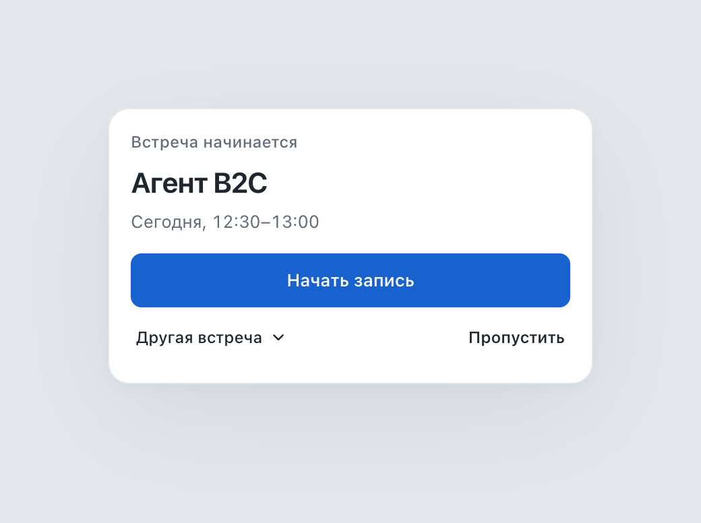
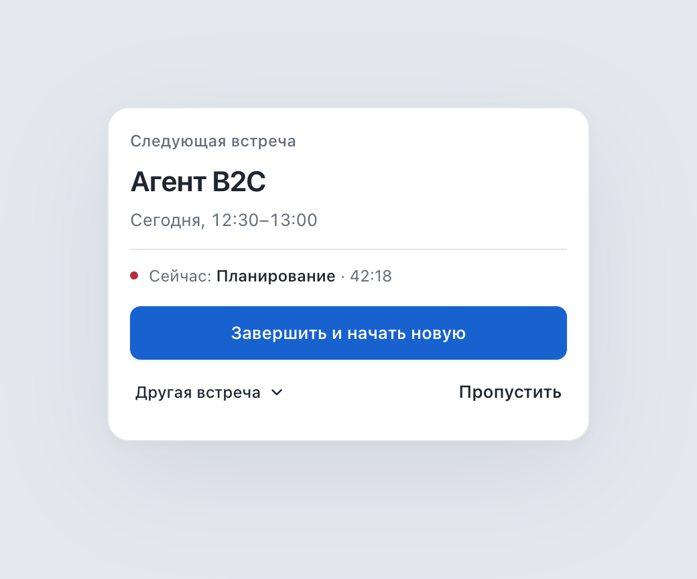
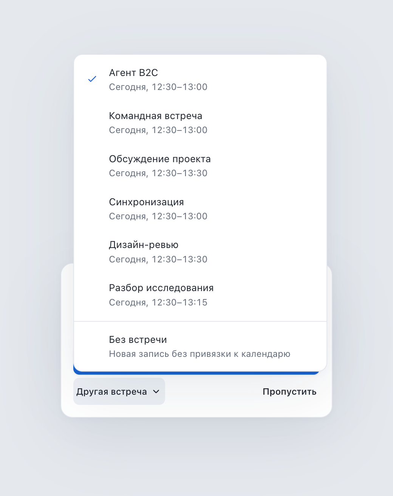

# Геометрия компактного напоминания

## Статус измерений

18 ноября 2026 выполнена фактическая отрисовка принятого HTML через Playwriter в открытой пользователем вкладке Chrome. Получены три PNG с реальным device scale 2× и измерения card/control rectangles и computed styles. Никакие размеры макета для съёмки не менялись; менялись только viewport/theme/scale эмуляции, которые затем сняты.

Окружение: macOS, системный SF; Chrome 157.0.0.0; viewport 1280×900 logical units; devicePixelRatio 2; light; reduced motion; scale 100%. User agent с MacIntel — стандартная строка Chrome и не утверждение об архитектуре CPU.

Подробные исходные измерения: [measurements.json](measurements.json). Снимки фактические, не апскейл и не иллюстрации. Dark и узкий viewport отдельно в этом прогоне не снимались.

## Система единиц

HTML logical px соответствуют logical pt native макета при 100% zoom. При deviceScaleFactor=2 внешний frame 360 переводится в 720 raster px; 1-unit stroke — в 2 raster px. Скриншоты должны иметь нативный 2× raster, а не быть увеличенной копией 1×. Тень не включать в измеряемый frame.

## Постоянная геометрия

| Элемент | Logical размер | Как воспроизвести |
| --- | --- | --- |
| Outer card | 360 wide, max available | Border-box: padding и stroke уже внутри 360 |
| Outer border | 1 | Внутри frame, не hairline 0.5 |
| Outer radius | 16 | Все четыре угла |
| Inner padding | 16 с каждой стороны | От внутреннего края border |
| Content width | 326 при outer 360 | 360 − 2 × (16 + 1) |
| Primary width | 326 | Вся content width |
| Primary min height | 40 desktop / 44 mobile | Может расти с переносом текста |
| Primary radius | 8 | Не стандартный system radius |
| Primary vertical padding | 9 | Final height max(min-height, content + 18) |
| Primary horizontal padding, idle | 12 | Включён в content box кнопки |
| Primary horizontal padding, recording | 8 | Сохранён более специфичным правилом recording cascade |
| Secondary row gap | 8 | Между trigger и skip |
| Primary → secondary row | 4 | Между frame блоков |
| Secondary controls, desktop idle | 36 | Trigger и skip; padding 8 vertical / 4 horizontal |
| Secondary controls, desktop recording | Trigger 36, skip 40; row 40 | Recording selector повышает skip до 13 pt и min-height 40; это часть принятого cascade |
| Secondary controls, mobile | 44 | Оба control target при viewport до 480 |
| Trigger icon | 16 × 16 | Chevron, gap от подписи 4 |
| Trigger/icon stroke | 1.7 в SVG viewBox 24 | При размере иконки 16 effective raster stroke ≈ 1.133 logical, а не 1.7 pt |
| Calendar chooser width | 336 maximum | На узком экране viewport − 32 |
| Chooser radius / border | 12 / 1 | Footer divider тоже 1 |
| Chooser list/footer padding | 4 | Строки внутри surface |
| Option min height / padding | 52 / 10 | Реальная строка может быть выше 52 |
| Option radius | 8 | Selected/hover surface |
| Check slot / text gap | 20 / 12 | Check icon 16 × 16 |
| Option title → time | 2 | Grid gap внутри копии |
| Recording dot | 6 × 6 | Круг без outline |
| Dot → copy | 8 | Flex gap |
| Recording top margin | 12 | От previous block |
| Recording separator | 1 | Только сверху, не снизу |
| Separator → copy | 10 | Padding-top; отдельно stroke 1 |
| Actions top margin | 14 | После meeting/recording блока |
| Meeting top margin | 8 | После eyebrow |
| Time margin-top | 4 | Дополнительно к grid gap meeting |
| Meeting grid gap | 2 | Измеренный cascade; итоговый title → time gap 6 (2 + margin 4), не 12 |

## Типографика

System SF на macOS: -apple-system/BlinkMacSystemFont, затем Helvetica Neue/sans-serif. Не заменять на похожий шрифт при снятии эталона.

| Элемент | Size | Weight | Line height | Tracking |
| --- | --- | --- | --- | --- |
| Вводная строка | 12 | 500 | 16.8 | .01em = .12 |
| Название встречи | 21 | 650 | 26.25 | −.4 |
| Время | 13 | 400 | 19.5 | normal, tabular nums |
| Recording copy | 12 | 400, имя 550 | 18 | normal |
| Primary | 13 | 550 | 19.5 | normal |
| Secondary trigger, оба состояния | 12 | 500 | 18 | normal |
| Skip, idle | 12 | 550 | 18 | normal |
| Skip, recording | 13 | 550 | 19.5 | normal |
| Option title | 13 | 400 | 18.2 | normal |
| Option time | 12 | 400 | 16.8 | tabular nums |

650 и 550 — веса принятого browser variable/system font. Native реализация должна подобрать соответствующий SF weight по рендеру, не менять size и leading для компенсации.

## Цвета

| Token | Light | Dark |
| --- | --- | --- |
| Surface | #FFFFFF | #20242B |
| Text | #202630 | #F0F2F6 |
| Secondary | #626B79 | #A4ADBC |
| Border / divider | #E3E7ED | #353C47 |
| Hover | #EDF1F6 | #303844 |
| Primary | #1762CF | #8AB9FF |
| Primary text | #FFFFFF | #15243B |
| Primary hover | #1055B8 | #A6CAFF |
| Recording dot | #B82D3D | #FF9AA8 |
| Focus | #1762CF | #8AB9FF |
| Demo canvas (не native panel) | #E5E9EE | #101319 |

Surface shadow light: x0 y24 blur80 rgba(36,52,74,.102) и x0 y2 blur8 rgba(36,52,74,.039). Dark: x0 y24 blur80 rgba(0,0,0,.333) и x0 y2 blur8 rgba(0,0,0,.2). Primary shadow: x0 y1 blur2 rgba(0,0,0,.067). Focus ring: 3 logical units, offset 4. Native focus допускает системный accessibility rendering без изменения resting geometry.

## Высоты и содержимое

Общая высота зависит от содержимого. Измеренные outer frames с коротким названием «Агент B2C» и временем «Сегодня, 12:30–13:00»:

| Блок | Idle logical W×H | Recording logical W×H |
| --- | --- | --- |
| Внешняя карточка | 360 × 204.546875 | 360 × 249.546875 |
| Eyebrow line box | 326 × 16.796875 | 326 × 16.796875 |
| Meeting block | 326 × 51.75 | 326 × 51.75 |
| Title line box | 326 × 26.25 | 326 × 26.25 |
| Time line box | 326 × 19.5 | 326 × 19.5 |
| Recording block, border included | отсутствует | 326 × 29 |
| Actions block | 326 × 80 | 326 × 84 |
| Primary | 326 × 40 | 326 × 40 |
| Secondary row | 326 × 36 | 326 × 40 |
| Trigger | 121.5859375 × 36 | 121.5859375 × 36 |
| Skip | 79.6171875 × 36 | 84.8203125 × 40 |

Сумма outer height idle: 34 (два padding 16 + border 1) + 16.796875 + margin 8 + meeting 51.75 + margin 14 + actions 80 = **204.546875**. Recording добавляет margin 12 + recording block 29 + увеличение actions 4 = **249.546875**.

Начальные оценки 210.55/251.55 заменены фактическими данными: не использовать их при реализации. Отличия recording skip 13 pt / 40 pt и idle skip 12 pt / 36 pt не нормализовать незаметно — это текущий принятый эталон.

Открытый chooser при данном viewport: **336 × 420**, первая обычная строка **326 × 56.9921875**, footer **334 × 65.9921875** включая divider 1 и padding 4 с каждой стороны. Minimum row 52 не является фактической высотой: две строки шрифта с gap 2 и padding 20 дают 56.9921875. Scroll content height 710, client height около 352; все 12 встреч находятся в прокручиваемом списке.

При открытии chooser карточка осталась **360 × 204.546875**, без изменения frame. В данном расположении chooser открылся вверх от trigger, перекрывая часть карточки; это ожидаемая top-layer компоновка, не расширение родителя. Длинные названия увеличивают высоту своих блоков по реальным line boxes, без изменения padding/font size.

Список: JS ограничивает высоту значением min(420, viewportHeight−32, max(260, доступная высота)); размещение clamp к краям 16. Native implementation сохраняет смысл ограничения по visibleFrame и скролл, не обязана копировать browser JS. При малой высоте приоритет — полностью доступные выбор/скролл/footer.

## Приложенные скриншоты 2×

| Состояние | PNG | Raster size | Содержимое |
| --- | --- | --- | --- |
| Без текущей записи | [idle.png](screenshots/idle.png) | 1040 × 776 px | Карточка 720 px шириной плюс поле для тени |
| Текущая запись | [recording.png](screenshots/recording.png) | 1040 × 866 px | Карточка 720 px шириной плюс поле для тени |
| Открытый список | [chooser.png](screenshots/chooser.png) | 1040 × 1312 px | Карточка и popover 672 px шириной, все 12 кандидатов в scroll content |

У PNG имеются внешние поля: ширина всего изображения 1040 px не означает ширину карточки 520 pt. Frame карточки — ровно 360 pt / 720 raster px. Из-за дробной высоты crop округлён rasterizer; таблица rectangles хранит точные logical measurements, а не деление полной PNG-высоты на два. Демонавигация в product crops не включена.

## Граница проверки

Снимки и измерения подтверждают геометрию текущего HTML в указанном desktop/light окружении и неизменность frame при открытии chooser. Они не подтверждают native реализацию, capture/session outcomes, dark/mobile UAT, сборку приложения или OpenSpec validation. Эти задачи остаются открытыми.
