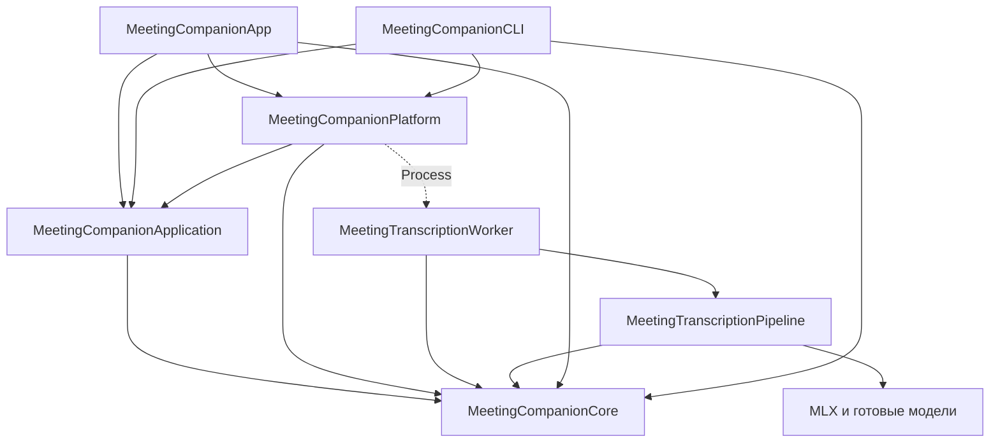

# Design

## Context

База приложения: `master` `520f7d3a9d826d14c26380dc502aa3007b531760`, включая
редактор из `0ad85002f9e673d68370d0420b4553c797088360`. Worktree обновлён
fast-forward; экспериментальные PoC сохранены отдельно от реализации приложения.
Исторический Python full-MLX snapshot из [baseline.md](baseline.md) используется
для сравнения моделей; текущий master задаёт контракт редактора и артефактов.

Начало реализации разрешено владельцем 2026-11-02. ADR-0001 и ADR-0002 accepted;
границы модулей ADR-0003 приняты владельцем 2026-11-02 перед запуском реализации.
Текущие требования
содержатся в specs, порядок работ — в tasks.md, результаты — в verification.md.

## Goals / Non-Goals

Цель: standalone test app без Python/uv, с готовыми Swift/MLX реализациями,
локальной подготовкой весов и проверяемым сохранением поведения.
Сценарии записи, обработки и редактирования должны использоваться независимо
от SwiftUI/AppKit, чтобы переделка интерфейса сохраняла логику и формат данных.
Измерить время/память без обещания улучшения. Не менять захват, AEC DSP, редактор,
личности спикеров, версии моделей молча, установку и публикацию приложения.

## Decisions

### Границы модулей приложения

Согласованное решение: [ADR-0003](../../../adr/0003-separate-application-from-ui.md).
Границы закрепляются отдельными SwiftPM targets, чтобы компилятор проверял
направление зависимостей. Одних каталогов внутри нынешнего Core недостаточно:
они позволяют снова вызвать UI из обработки.

Сейчас `RecorderViewModel` в `AppMain.swift` владеет `RecordingWorkQueue`,
`processRecording`, проверкой моделей, экспортом и обновлением истории.
`RecordingHistory.swift` объединяет Codable-данные, запись `.processing.json`
и `ObservableObject`. В Core вместе находятся capture, subprocess, хранение,
editor sessions и window state. Это исходные места разделения.

| SwiftPM target | Ответственность | Прямые внутренние зависимости |
|---|---|---|
| `MeetingCompanionCore` | Контракты записей, JSON v1 и progress; валидация; версии, edits/CAS/undo, speaker assignment, interval index, экспорт и файловые правила хранения | Нет |
| `MeetingCompanionApplication` | Сценарии записи/остановки, последовательная очередь export→transcription, подготовка, retry/cancel, состояние истории, review session и playback controller; интерфейсы внешних операций | Core |
| `MeetingCompanionPlatform` | macOS capture/permissions/devices, audio export, `Process` client worker, AVPlayer transport; разрешение bundle/resource paths | Application, Core |
| `MeetingTranscriptionPipeline` | PCM readers, модели и их adapters, VAD/ASR/diarization/correction/merge, producer и атомарная публикация результата, manifest/download; MLX dependencies | Core |
| `MeetingTranscriptionWorker` | CLI arguments, сборка pipeline, progress stdout, exit/cancellation | Pipeline, Core |
| `MeetingCompanionApp` | SwiftUI/AppKit, окна, view models, отображение ошибок/прогресса, calendar/reminders/updater; сборка зависимостей | Application, Platform, Core |
| `MeetingCompanionCLI` | Разбор пользовательских команд и вывод; сборка тех же сценариев записи/обработки | Application, Platform, Core |

В схеме стрелка означает compile dependency; пунктир — запуск процесса:



Core остаётся ограниченным модулем контрактов и хранения записей/транскриптов.
Foundation и существующий POSIX file locking допустимы: переписывать надёжные
repositories ради формально чистого domain слоя не требуется. AVFoundation,
ScreenCaptureKit, AppKit, SwiftUI, Combine и MLX здесь отсутствуют. Pipeline
не зависит от Application/Platform; AEC helper запускается его собственным wrapper.

Application определяет только нужные границы: capture session, audio exporter
и worker client (`check/availability/prepare/run/cancel`). Они принимают Core
value types, paths и snapshots, возвращают результат или типизированную ошибку.
Platform реализует эти операции; App/CLI передают реализации при создании
application services. Текущий `TranscriptPlaybackTransport` переиспользуется.
Для каждого класса новый protocol не нужен; существующие файловые repositories
остаются конкретными. Общего service locator, plugin registry и event bus нет.

#### Владение состоянием и временем жизни

- Один application service владеет очередью и активной обработкой на время
  жизни приложения. Он сериализует export/transcription, хранит jobs и их
  snapshots; настройки Parakeet/AEC фиксируются при enqueue. Capture продолжает
  работать независимо от этой очереди. Предикаты busy/active для команд,
  установки и завершения читаются из application state.
- Закрытие окна или пересоздание view model снимает подписку на snapshots,
  сохраняя job. Новый UI читает текущий snapshot и подписывается на изменения.
  Отмена — явная команда по job ID; результат предыдущего запуска не обновляет
  retry. Потеря progress-подписчика не означает отмену worker.
- Очередь сериализует переходы состояния, но не исполняет model/file/audio work
  на MainActor. Process I/O и экспорт выполняются adapters вне UI executor;
  progress передаётся по существующему wire protocol. Фаза completed возможна
  только после успешного exit и проверки опубликованных артефактов.
- Recording session владеет recorder и состоянием start/stop/mute; после stop
  передаёт финализированные источники в processing service. Capture timestamp,
  обработка warning и сохранность CAF/WAV остаются обязанностью текущего backend.
- Существующие `@MainActor` review session и playback controller сохраняют
  actor isolation. Новая модульная граница сама по себе не меняет потоковость
  edits repository и его locking/CAS. UI принимает snapshots на MainActor.

History value types и чтение/запись metadata отделяются от Combine-обёртки.
Один application history store обслуживает обработку и current capabilities редактора;
сохраняются merge unknown fields, атомарность, canonical paths и текущие проверки.
UI не ведёт вторую копию записываемой истории. Ошибки сохранения доступны в
application state; обработка не объявляет сохранение успешным при ошибке записи.

Progress/status содержат stage, source, counters и outcome. Тексты `.text`,
подписи источников, советы и форматирование ошибок для экранов принадлежат App;
CLI имеет собственное представление тех же данных. Существующие поля/messages
на диске и в wire protocol сохраняются при выделении модулей.

#### Карта переноса существующих компонентов

| Сейчас | Предлагаемое размещение |
|---|---|
| `TranscriptDocument`, edits repository, version selector, speaker assignment, interval index, export | Core, существующие проверки и API сохраняются |
| `TranscriptReviewSession`, `TranscriptPlaybackController` и transport protocol | Application; существующие sessions/controllers переиспользуются |
| `AudioCapture`, platform-части `RecorderCore`/`SourceAudioFiles`, `TranscriptAVPlayerTransport` | Platform; DTO/configs без framework types — Core |
| `Transcription.swift` | Progress DTO/decoder — Core; process runner/resource lookup — Platform; последовательность check/prepare/run — Application; presentation `.text` — App |
| `RecordingHistory.swift` | Codable values/path/persistence — Core; authoritative history state — Application; ObservableObject — App |
| `RecordingWorkQueue`, enqueue/processRecording и recording lifecycle из `RecorderViewModel` | Application services; App model сохраняет UI selection, capsule, dialogs и подписку |
| `TranscriptWindowCoordinator`, `TranscriptFollowState`, NSWindow/SwiftUI и drafts | App; закрытие окна управляет только его review/playback session |
| `TranscriptReviewWindowModel` | View rows/drafts/confirmations/save panel — App; вызовы существующих session/repository/export сервисов сохраняются |

#### Порядок выделения и проверка границ

1. Сохранить базовые editor/preview tests и JSON fixtures для принятого ADR-0003.
2. Выделить Core contracts и Pipeline/Worker targets; сохранить текущий reader,
   encoding и правила хранения. Pure pipeline algorithms проверять без моделей.
3. Выделить Application/Platform, перенести queue/process/history orchestration,
   затем recording session. Подключить нынешние App и CLI через их точки запуска.
   Каждый перенос сохраняет ошибки и текущие guards; работающий UI остаётся
   потребителем тех же сценариев. Модельные исследования могут идти отдельно.
4. Проверить Package graph/imports, сборку App/CLI/worker и соответствующие
   Swift test targets. Application/Core tests выполняются без App, окон и MLX;
   worker integration tests выполняются отдельно с pinned weights.
5. Проверить enqueue→close UI→reconnect→completion, cancel→retry со stale events,
   запись параллельно обработке, persistence failure и текущие editor/preview
   контракты. Затем выполнить ручную регрессию окон, записи и воспроизведения.

Это поэтапное выделение существующего кода, без смены формата данных. Тестовые
helpers, self-check scripts и imports обновляются вместе с владельцем API;
временные совместимые forwarding imports допустимы только до перевода callers
в том же срезе, постоянный дублирующий facade не нужен.

### Процесс на одну запись

Приложение запускает bundled `MeetingTranscriptionWorker` через `Process`, без
shell и Python. Worker получает те же параметры recording/offline/parakeet/AEC,
обрабатывает host и remote последовательно внутри каждого этапа модели
и завершает процесс после результата,
ошибки или отмены. `--prepare`, `--check`, `--availability` обслуживаются тем же
executable. UI получает существующий поток `MEETING_PROGRESS {json}` и exit status.
Weights, MLX/Metal и их ресурсы находятся только у worker.

Это сохраняет существующую subprocess-границу, изолирует GPU/model faults от
захвата и освобождает адресное пространство моделей при завершении. Exit не
обещает мгновенного снижения системного GPU accounting; освобождение проверяется
после ожидания завершения процесса. На протяжении записи модели не нужны.
Долгоживущий XPC service добавляет lifecycle, in-process inference связывает
память и падения с recorder. Дополнительных model workers пока не вводим.

Контракт результата общий для приложения и worker. MLX products линкуются только
в worker closure; UI обращается к сценариям приложения, а process adapter
реализует запуск worker. Зависимости подробно описаны ниже.

### Одна загрузка модели на запись

Расписание worker сохраняет порядок моделей, но переносит цикл по дорожкам
внутрь этапа:

```text
Nemotron: host → remote → освободить
VAD:      host → remote → освободить
GigaAM:   host → remote → освободить
Назначить спикеров и сохранить исходный GigaAM в staging
Parakeet: host → remote → освободить (если включён)
Коррекция терминов, объединение и публикация версии
```

На успешном запуске с двумя непустыми дорожками и всеми этапами нужны четыре
загрузки вместо восьми. Отключённый или не требующий inference этап не загружает
модель. Веса переиспользуются; inference state создаётся заново для каждого
источника. Для Nemotron это включает историю голосов/cache, для VAD состояние
и аудиоконтекст. Остальные adapters также не переносят decoder state между
источниками. Способ reset/new session подтверждается исходниками и проверками
двух дорожек, а не предположением о stateless API. Аудиопотоки не смешиваются,
параллельного inference нет.

Перед загрузкой следующей модели завершить lazy GPU work и освободить ссылки
на предыдущую модель, её state и временные tensors. Между этапами хранить маски,
интервалы и слова; не удерживать обе полные PCM-дорожки и вычислительные графы.
MLX allocator cache содержит свободные блоки, не каталог объектов моделей.
Освобождение объектов не означает немедленного снижения RSS; измеряется отдельно.

При source-local сбое сохраняются прежние fallback/warning этого источника;
продолжение допустимого этапа для второй дорожки получает чистое состояние.
Общий сбой загрузки модели обрабатывается для всех затронутых источников по
прежним правилам этапа. Fatal ASR по-прежнему блокирует успешную публикацию.
Ошибка необязательного Parakeet не теряет уже сохранённый исходный GigaAM.

### Готовые реализации и общий MLX

Выбран набор и способ устранения конфликтов из research.md: MLXAudio STT/VAD,
минимальный upstream source GigaAMKit и dependency closure SpeechVAD Nemotron.
Один MLX Swift 0.32.3, pinned source revisions, lock-файл, лицензии и небольшой
patch ledger. Сначала проверить сборку и upstream tests. Никаких самостоятельных
реализаций Conformer, RNNT, TDT или Nemotron Transformer.

Разделить несовместимость API и несовместимость весов. Небольшие adapters доступа
к trace, выбора branch, dtype/key layout допустимы после TDD/strict validation.
Изменение архитектуры сети, подбор иных моделей или отказ от MLX требуют нового
решения. Если source closure оказывается больше/сложнее package-подключения,
пересмотреть выбор до vendoring и обновить patch/dependency inventory.

### Профиль реализации после PoC

На 2026-10-31 общий graph четырёх моделей на MLX Swift 0.32.3 уже собран и
выполнил offline inference. Это закрывает исследовательскую неопределённость
совместимости, но не tasks продуктового API, licensing, tests и packaging.
Выбранный план реализации использует следующие immutable HF snapshots:

| Модель | Snapshot revision | Хранение и исполнение |
|---|---|---|
| `kruatech/gigaam-v3-mlx` | `2478743c1c449a468ee163bc3030170d1a2e81fb` | F16 weights без eager expansion cache; F32 FFT/window/filter assets и activations, promotion штатных операций |
| `mlx-community/Nemotron-3-Diarization` | `59ed2dbfc1346dcea9d423c71306a3a2499c568f` | исходный BF16 checkpoint/source `723e19c601d99b7e58fba6a14e32153e0afe48d9`, baseline DSP и offline preset |
| `mlx-community/silero-vad-v6` | `2ebf4a5e10726a2e78ddd4d70eedfb6f1c33eb06` | F32, strict 16 kHz branch, прежние thresholds/state/segmentation |
| `craquehouse/parakeet-tdt-0.6b-v3-mlx-8bit` | `29d291a62b4013d74a24d79fca00883b717d988a` | Q8/group64, F16 waveform до frontend и F16 dense compute; включается пользователем |

GigaAM FFT/matmul сохраняет geometry/assets/clamp; Accelerate max/index читает
общую MLX memory через public API с удержанием lifetime и прежними score/ties.
GPU argmax отклонён измерением. F32 GigaAM weights cache используется как
измерительный control. Более низкая stored precision сама по себе не
доказывает меньший RSS и не означает inference целиком в этом dtype.

Для оценки языкового эффекта используется same-export/same-dtype Python/Swift
пара; выбранный продуктовый профиль отдельно сравнивается с reference.
Текущие сравнения используют зафиксированные revisions и новые результаты.

Parakeet PoC использует `@testable import`/`-enable-testing` ради token timings.
Продуктовая задача — public timing API upstream либо минимальный объявленный
public adapter в pinned source, без переписывания decoder. Обычный release build
должен собираться без test visibility и сохранять полные token/journal checks.

### Ограниченная память VAD и измерения ресурсов

Сохранённые полные часовые runs: Python RSS достигает1.933GiB на VAD, Swift
F16+FFT —2.076GiB; MLX allocator cache после VAD около724MiB у обоих. Active
allocations после прохода порядка1.2MiB сверх Python harness baseline. Это
указывает на необходимость profiling временных copies/graphs/cache, но не
идентифицирует конкретную утечку. `ru_maxrss` — high-water всего процесса;
уменьшение MLX weights не означает снижения этого peak. Исходники/raw metrics
и раздельная трактовка сведены в verification.

Сначала VAD-only probe и profiling checkpoints, затем bounded PCM reader и
усиленная detection copy только текущего блока. Оригинал читается неизменным;
не хранить две полные decoded PCM-дорожки, усиленные копии и графы всей записи.

Нарезка начинается на уровне чтения файла: открыть исходный WAV, проверить
формат/header и последовательно декодировать ограниченные порции. Вариант
«прочитать час целиком, затем передавать slices» не выполняет memory contract.
SHA-256 также считать последовательным чтением, без полной `Data(contentsOf:)`
копии. Дополнительные WAV-файлы не нужны. Размер PCM read block,512-sample
model feed и25/24s ASR window — три независимые границы. Неполный feed хвост
переносится между чтениями; padding выполняется только на настоящем EOF.
Контекст64 samples и recurrent/segmentation state продолжаются через read
boundary; absolute offsets вычисляются по sample counter исходного WAV.

Отдельная PoC-проба 2026-10-31 подтвердила этот подход на M3 Pro 18 GiB:
для двух дорожек по 61 min peak RSS 2146.7 → 65.9 MiB, MLX peak отдельно
671.91 → 2.71 MiB при точных probabilities/intervals/masks. Reader получает
160000 samples за чтение; независимый вычислительный блок — 320 feeds
(10.24 s), с прежним async eval каждые 16 feeds. Синхронный readback каждые
16 feeds оказался медленнее и отклонён. Hash требует autorelease pool на
каждую файловую порцию: одного инкрементального API недостаточно для bounded
RSS. Это выбор исследовательской пробы, не внедрение в основной worker;
методика, ablation и исторические ограничения — в verification.

GigaAM/Parakeet читают из того же неизменного WAV только нужные исходные ASR
окна по absolute offset, с прежним overlap; усиление VAD туда не попадает.
Перечитывание окна с диска допустимо ради ограниченной памяти. Nemotron сохраняет
прежний offline preset и непрерывную историю голосов: независимый запуск модели
на каждом файловом куске не заменяет существующую диаризацию всей дорожки.

Состояние 512-sample feed,64 context, hysteresis, sample indices и EOF сохранять
между блоками одного источника; сбрасывать только на смене источника. Оконная
сетка ASR не становится сеткой независимых VAD-запусков. После обработки хранить
компактные masks/intervals; полные probabilities нужны диагностическому harness,
а не в рабочей памяти продукта. Их можно писать последовательно в evidence.

Для проверяемой логики сначала RED: variable block size, seam/EOF, тишина,
100/25/5% речь, immutable PCM, source reset и optional failure. Затем GREEN,
точное сравнение masks/intervals и downstream content до/после при том же профиле.
Performance проверяется отдельной серией, не flaky unit timing assertion.
Замена модели или 256 ms aggregation не является частью этой оптимизации.
Reader checks должны также наблюдать фактические read/decode requests и объём
live PCM buffers: одинаковая итоговая маска после slices сама по себе не
доказывает отсутствие предварительной полной загрузки. Проверять размеры порций,
не кратные512, и read boundaries внутри речи/ASR overlap, затем полный file-to-mask
probe с включёнными reader/hash costs в memory/time measurement.

Измерения выполняются
на доступном Mac: individual runs/medians, конфигурация, RSS и MLX отдельно,
pressure/swap, cancel/retry и отзывчивость UI. Проверки bounded I/O, model teardown,
отсутствия OOM и сохранности выбранного профиля входят в приёмку.

### Подготовка и локальные веса

Model manifest хранит repository, immutable revision, файлы, SHA-256, format,
stored/compute dtype, quantization и profile. Каждая модель имеет независимую
проверку готовности. Модель загружается только явной подготовкой; worker inference
принимает уже проверенный directory и не вызывает `fromPretrained`.

Скачивание идёт в app-owned staging, с валидацией и атомарной публикацией snapshot.
Cancellation/ошибка не создаёт ready-состояние и не удаляет ранее исправный cache.
Пути manifest ограничены snapshot, запрещены traversal и symlink escape.
UI показывает model progress и проверяемые ошибки без сообщений об установке Python.
Существующие Python/shared caches автоматически не удаляются. Нужны поддержка
пустого isolated cache и повторная подготовка после повреждения файла.

Использовать готовый pinned Swift download client из выбранных зависимостей,
если поддерживает revision и cancellation. В противном случае небольшой
URLSession downloader для фиксированного manifest, без отдельного Hub framework.
Выбор фиксируется тестом до реализации. Пользовательское аудио не передаётся
ни downloader, ни upstream API. Inference не делает сетевых запросов.

### Перенос управляющей логики

Публичные границы для TDD: PCM reader/window plan, VAD mask, model word adapters,
speaker assignment, correction cascade, chronological merge/paragraphs, artifacts,
process lifecycle. Проверки используют синтетические fixtures, перед портом
выводы Python фиксируются в differential oracle. Golden fixtures не заменяют
отдельные assertions на инварианты, ошибки и неоднозначные случаи.

Сохранить exact tie order и `SequenceMatcher(autojunk=False)`, а не незаметно
заменить difflib похожим алгоритмом. Переносится управляющая логика продукта;
архитектуры нейросетей остаются upstream. Настройки моделей берутся из pinned
профиля и baseline.md, правила группировки/артефактов — из текущего master.

При сбое VAD проходят все окна с warning; сбой Nemotron сохраняет baseline ASR
с placeholder attribution и warning; Parakeet или journal failure возвращает
GigaAM. Fatal ASR не публикует успешную версию, но сохраняет audio/log и retry.
Не сбрасывать количество голосов при исключении молча в подтверждённый ноль.

### Результаты, прогресс и отмена

Каноническая база приложения — `master` `520f7d3a9d826d14c26380dc502aa3007b531760`
(редактор добавлен `0ad85002f9e673d68370d0420b4553c797088360`). Исторический
Python full-MLX snapshot остаётся reference моделей; он не задаёт формат редактора.
Сохраняются TXT, baseline GigaAM, per-source corrections и существующий JSON v1.
Producer contract: `transcription/transcript_document.py`, `transcript_mix.py`;
reader contract: `TranscriptDocument`, `TranscriptVersionSelection`, edits/export.
Порт использует общие `Tests/Fixtures/transcript-document/`, не создаёт
вторую схему и не меняет UI ради native output.
JSON содержит обязательные `schemaVersion=1`, `resultID`, `createdAt`, `sources`,
`speakers`, `words`, `turns`, `baselineWords`, `aec`, `playback`, `warnings`, `context`.
Nullable значения сериализуются явно: `context`, `detectedVoiceCount`, `mixPath`,
`warning.sourceID`; отсутствие ключа не эквивалентно null. Времена/ссылки/ID
валидируются существующим reader, speaker labels не кодируют личность.
Publication: staging `raw/.transcript-*` вне discoverable version directory,
затем атомарный rename в `raw/transcripts/<resultID>/` с готовым `result.json`.
При AEC applied сохраняется неизменяемая копия `microphone.wav` версии; `mix.m4a`
построен из фактически распознанного микрофона и remote на общей шкале.
Общий `<base>.m4a` для Quick Look в истории остаётся отдельным capture/export
артефактом: native worker его не перезаписывает. Редактор читает только mixPath
выбранной версии. `edits.json` с revision/CAS/undo и экспорт
сохраняются; selectedResultID игнорируется без миграции и автоматического назначения пользовательских имён.

Новая попытка создаёт отдельную staging/version, не трогает recognition/edits
предыдущей. Ошибка mix даёт text-ready/playback-unavailable с warning, без
дополнения опубликованной версии задним числом. Legacy flat layout читается.

Сохраняются имена stages и поля `channel`, `completed`, `total`, `step`, `steps`,
`warning`. Diagnostics остаётся отдельной командой, шумные model logs не
интерпретируются как события. Ошибки содержат actionable message и путь к логу.
`step/steps` вычисляются по новому плану пар этап/источник, а не прежней формуле
channel-first. Общий прогресс не уменьшается при переходе host → remote или
к следующей модели; skipped/fallback этапы корректно закрываются. Проверить
Parakeet on/off, пустую дорожку и AEC on/off без изменения event schema.

Существующий `Transcription.run` не связывает Swift Task cancellation с process.
Нельзя считать отмену уже доказанной: worker lifecycle и runner проходят TDD
в этой задаче, без добавления новых UI-кнопок. Отмена завершает worker и его
AEC child, при необходимости после 2 с SIGTERM применяется SIGKILL. Caller ждёт
exit и EOF, unfinished staging не публикуется, задача не становится completed.

### AEC и capture

Capture файлы/engine не меняются. Существующий native `meeting-aec` helper и его
DSP/flags остаются прежними. Для отсутствия Python переносится только wrapper:
те же PCM validation, offsets/frame count, bypass нулевого remote, progress,
временный WAV, проверки длины, исходный host при сбое и warning.
Это замена orchestration, не изменение алгоритма. Проверить byte equality
helper output и поведение bypass/failure. Если для этого требуется менять DSP,
остановиться и согласовать отдельную задачу. AEC выключен в основном сравнении
моделей; проверка wrapper выполняется отдельно с одинаковым helper.

### Карта совместимости редактора и превью

| Граница | Сохранить | Источник истины |
|---|---|---|
| JSON v1 | `schemaVersion`, `resultID`, `createdAt`, `sources`, `speakers`, `words`, `turns`, `baselineWords`, `aec`, `playback`, `warnings`, `context` | `transcription/transcript_document.py`; `Sources/MeetingCompanionCore/TranscriptDocument.swift` |
| Null/status | явные nullable `context`, `sources[].detectedVoiceCount`, `playback.mixPath`, `warnings[].sourceID`; completed/disabled/failed; неизвестное число голосов не равно нулю | текущий reader и общие fixtures |
| Идентичность и время | уникальные ID, стабильность внутри версии; source-local host/remote voices, уникальные displayNumber; абсолютные времена и пересечения, связь turn→word | `build_document`, `TranscriptDocument` validation |
| Публикация/current | `.staging-*` вне discovery; rename JSON/audio/text в `raw/transcripts/<resultID>/`; creation date/name до schema validation; новые ID на retry | `TranscriptPublisher`, `TranscriptResultStorage` |
| Аудио версии | `mix.m4a` из фактического ASR-микрофона и remote; AEC applied — неизменяемый `microphone.wav` версии; ошибка mix оставляет текст и warning | `transcript_mix.py`, `publish_result`, playback checks |
| Правки/экспорт | существующие `edits.json`, revision/CAS/undo и export allowlist; selectedResultID игнорируется; нет переноса правок и GUI истории результатов | `TranscriptEditsRepository`, `TranscriptResultStorage`, `TranscriptExport` |
| Превью истории | прежний `<base>.m4a` из `RecordingEntry.recording`, `quickLookPreview` | `RecordingHistory.swift`, `RecordingHistoryView.swift` |
| Старые записи | legacy flat WAV/TXT, повторный поиск источников после создания raw/, read-only TXT без структурированного документа | `source_paths`, history/window selectors |
| Остальные артефакты | `<base>.sources.transcript.txt`, raw per-source/baseline/corrections/logs, `.processing.json`, `.context.json`, capture report | `transcribe-recording.py`, `RecordingEntry` |

При переносе `group_turns` брать правило из текущего master: pause < 2 s,
максимальная реплика 30 s, завершение по конечной пунктуации после 15 s,
разбиение по началам реплик другой дорожки. В `experiments/swift-pipeline-poc/`
сохранён прежний 15 s limit без этой punctuation branch; его нельзя скопировать
в native producer как текущее поведение. Нужны fixtures
на 15/30 s и пунктуацию из текущего Python, затем native RED/GREEN.

Микс версии и общий M4A — разные файлы с разными потребителями. Worker не
перезаписывает общий M4A и не использует его как замену отсутствующему миксу.
Paths внутри result.json относительны каталогу записи и проверяются на traversal,
symlink escape и alias исходников. Существующий reader не ослабляется ради producer.
Миграция результатов/правок не нужна. Новая метка recording format не добавляется; JSON v1 прежний, старые marker/selection поля сохраняются как unknown.

## Scope map

| Область | Границы реализации |
|---|---|
| `Package.swift`, worker source, pinned vendor source | worker-only MLX, upstream SHAs, product/dependency closure, Metal resources |
| Core/Application/Platform и App/CLI callers | выделение responsibilities по карте модулей, единое состояние processing/history, сохранение editor/capture API и проверок |
| `transcription/*.py` | внешний baseline сохраняется; runtime Python не копируется в test bundle |
| window/merge/correction/result modules, fixtures/tests | TDD-порт прежних правил, JSON v1 producer compatibility |
| `Transcription.swift`, checks, preparation diagnostics | native executable, прежние args/events/errors, cancellation/retry |
| Settings/Recorder UI strings | только подготовка и диагностика, без изменения recording UX |
| `scripts/build-app.sh`, `check-bundle.sh`, bundled checks | executable/metallib/dylibs/notices/signatures, запрет Python/uv в bundle |
| README, CHANGELOG, THIRD_PARTY, AGENTS, pipeline docs | проверенные команды, ограничения, offline preparation, licenses |
| Capture/recorder/AEC DSP/editor UI | вне изменений; regression checks и согласованная интеграция контрактов |

## Порядок реализации

1. Проверить текущий producer/reader/fixtures, selection, edits/export и preview
   как базовую границу. Это regression baseline, не приёмка ещё не написанного worker.
2. Первым продуктовым срезом выполнить native producer JSON v1: RED на отсутствующий
   producer, минимальный код, GREEN через существующий reader и downstream checks.
   Модельные выходы берутся из синтетических fixtures; веса не нужны для этой границы.
3. Выделять модули по карте выше, переносить model adapters/управляющую логику по tasks.md с RED/GREEN и текущими
   probes; переиспользовать проверенные PoC reader/logic и upstream архитектуры.
4. Проверить полный worker, lifecycle/cancel/retry, результаты/ресурсы и public
   Parakeet timing API. Затем подключать preparation/runner и собирать test bundle.

Порционный Nemotron frontend можно исследовать отдельно: он не блокирует первый
worker с прежним whole-file путём. Замена frontend требует exact BF16 сравнения.
Установка и релиз остаются отдельными действиями.

## Validation and acceptance

Один Mac и frozen inputs, отдельные новые output directories, SHA-256 до/после.
Порядок: unit adapters -> model probes -> full CLI -> review comparison -> app.
Параметры, corpus и численные пороги фиксируются перед новой продуктовой серией.
Строгие значения по умолчанию описаны в evaluation spec; непрохождение не
маскируется изменением порогов после замера.

Same-weight/precision runs отделены от смены representation/checkpoint.
До оценки языкового эффекта сравнить frozen Python channel-first с отдельной
Python model-first копией, не изменяя snapshot. Проверить прежние semantic gates,
состояние дорожек, количество загрузок и время/память при одинаковых весах и
настройках. Затем сравнить Python model-first и Swift model-first. В manifest
записывать расписание и число фактических загрузок. Если одинаковое расписание
не удалось воспроизвести, эффект языка и расписания обозначить как смешанный;
не приписывать весь выигрыш Swift. Эта проверка не включает Python в поставку.

Nemotron сравнивается непосредственно в выбранном исходном BF16 профиле
Python/Swift. Для GigaAM проверяются фактические tensors,
tokenizer/frontend и выбранные stored/compute dtype, а не только имя bundle.

Для каждого профиля: один warm-up и 3 последовательных новых процесса, порядок
Python/Swift чередуется по повтору. Отдельная серия fresh-process launch/load
после подготовки; OS page cache не объявлять cold. Не выполнять варианты
параллельно; отсутствие других ML jobs фиксируется в run manifest.

Измерять wall launch-to-exit, model load с принудительным MLX eval/sync, VAD,
diarization, ASR, speakers, Parakeet, correction, merge/persistence и total.
До импорта MLX фиксировать process start. Parent monotonic clock включает spawn.
Между этапами синхронизировать lazy GPU work. `ru_maxrss`/`time -l` на macOS в
bytes, MLX peak/current отдельно с одинаковыми reset/sync points. Native AEC child
RSS, если есть, показывать отдельно. RSS и MLX allocations не складывать.

Packaging: release build без системных Python/uv в PATH, свежий isolated model
cache, preparation/cancel/retry/corruption/HTTP errors, затем offline check и
полная обработка. Проверить отсутствие сетевых запросов, Python executables,
scripts, packages, libpython и runtime installers; наличие MLX metallib и notices.
Сеть отключать/ограничивать только для тестового процесса, без изменения сети
пользователя. Подпись проверять у каждого helper/resource bundle и app целиком.

## Risks / Trade-offs

- Stock GigaAM probe собирается и работает на MLX 0.31.3 после отдельно
  разрешённой установки Xcode/Metal. Общий MLX 0.32.3 graph проверен отдельным CLI;
  использовать отдельный DEVELOPER_DIR без глобального переключения toolchain.
- Разные MLX ranges и большой SpeechVAD package -> небольшой pinned source
  closure и явный patch ledger, совместимость проверяется до product integration.
- Иные checkpoints/dtypes/frontends -> мосты сравнения или остановка.
- Token frame и слово имеют разные концы -> адаптер прежнего правила и fixtures.
- Swift RNNT/frontend могут быть медленнее Python -> измерить, не обещать скорость.
- Повторное использование модели может переносить state между источниками ->
  тесты reset/new session, свежая модель как reference и обратный порядок дорожек.
- Лицензия derived Parakeet не указана -> завершить provenance/notices до bundle.
- Редактор включён в текущую базу -> использовать его producer/reader/fixtures;
  повторить contract checks при изменении базового commit, не копировать dirty files.

## Migration Plan

До приёмки сравнения native worker не подключается к приложению; installed
bundle не меняется. После приёмки подключить worker только в test branch,
сохранить Python snapshot и его environment
для сравнения вне bundle. Не удалять старые caches или данные автоматически.
При регрессии использовать прежний app artifact после отдельной команды,
без скрытого fallback и без миграции/перезаписи транскриптов.
Stable version/release feed не обновляются. Test bundle с прежним ID и signing
identity сохраняется в dist, installed app не заменяется. Установка запрещена
при recording/preparation/processing и требует отдельной команды.

## Remaining implementation work

- Поэтапное выделение модулей из существующих Core/App по принятому ADR-0003.
- Поддерживаемый public Parakeet timing API и его регрессии без test visibility.
- Перенос bounded VAD/ASR reader с fallback/cancellation и измерениями на доступном Mac.
- При замене Nemotron frontend — exact BF16 сравнение; оптимизация frontend
  не блокирует первый worker с прежним whole-file путём.
- Source/license/provenance inventory и notices для поставляемых зависимостей/весов.
- Producer JSON v1, version/mix publication, текущие reader/edits/export/preview
  contract checks до подключения worker к приложению.

Начало реализации разрешено владельцем 2026-11-02. Готовность поставки определяется
проверками продукта по актуальным specs.

## Owner-authorized single-current simplification (2026-11-03)

[ADR-0004](../../../adr/0004-single-current-transcript.md) supersedes только history/selection
clauses. Один current по filesystem creation date/name выбирается до schema validation.
Нет picker, selected-version persistence, format marker/header/gates или async-switch route.
Старые duplicate markers/selection и точные unknown metadata сохраняются без discovery writes.
Поддерживаемый JSON v1 одинаков для Python/native; retry независимо требует exact raw/flat pair.

Publisher stages JSON, обязательный per-result TXT и companion artifacts, затем один atomic
no-replace directory rename. До него failure/cancel сохраняет prior current; после него B current
даже при root export/ack/status/cancel warning. Root TXT — derived cache. Platform/App/CLI
reconcile committed disk state после teardown и не выдают stale root TXT за результат.

Application retry admission резервирует запись до await редактора, разрешает save/discard/cancel,
закрывает session и блокирует editable reopen через queue/worker teardown. Terminal reopen
разрешает current заново. Text/name edits, CAS/undo/export/playback и ordinary close protection
сохранены; старые правки не переносятся. Нет новой manifest/pointer authority или моделей.

Nonthrowing status updates удерживают terminal snapshot/warning при disk failure, освобождают
worker и допускают retry. Throwing durable updates сохраняют all-or-nothing cache/disk semantics.
Ordered service snapshots/reattachment и awaited off-MainActor history filesystem work сохранены.
Read-only TXT использует contained reader, без внешнего редактора. UAT — WAITING_UAT.


## Latest owner cutoff — ADR-0005 (2026-11-03)

Full functionality requires canonical folder basename == recording stem, independent of raw existence/age/producer/markers. Standard capture starts before raw exists; valid structured data without originals retains editor/playback. Retry separately requires exact contained raw host+remote WAVs, never automatic flat fallback. Nonstandard placement is list + available standalone contained saved TXT read-only, with no shared structured lookup, context/calendar mutation, durable history writes, capture or processing. Flat display metadata stays at its exact root path even if raw appears. Enforce guards before side effects in Application enqueue/start, every durable history writer, Platform Recorder/Transcription, and Worker recording mode. Explicit developer pair mode keeps its separate output-directory contract. Preserve all files and prior one-current/publication/draft/service safeguards; no migration. This supersedes earlier flat-retry clauses only; accepted ADR1–4 remain unchanged.


## UAT baseline-speaker correction (2026-11-03)

Restore the existing same-original-speaker admission rule before cascade candidate scoring/selection; no other search/scoring changes. Extract Stage6 unchanged into an internal pure PipelineRunner assembly function for model-free production-boundary regressions. Derive each source registry from final and actually serialized baseline references (nil → 1), and remote offset from that same complete host registry. Keep disabled/failed baseline substitution, IDs, strict validator, publication and source separation unchanged. No schema/model/algorithm redesign or recovery claim for the failed recording.
